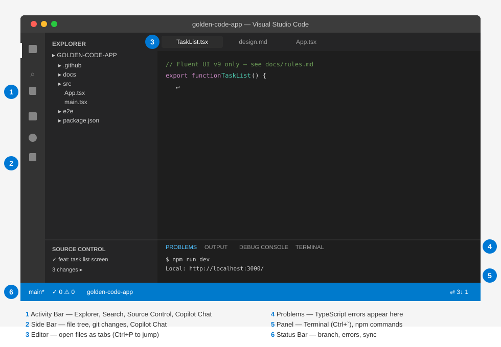

# 🧑‍💻 VS Code basics (zero experience needed)

New to VS Code? This page teaches you the four things you need for the whole session. Everything can be done with clicks — the terminal is optional.

## 1. Find your way around the window



| # | Area | What it is — and what you use it for |
|---|---|---|
| 1 | **Activity Bar** (left edge) | Switch between Explorer, Search, Source Control and Copilot Chat — one click each |
| 2 | **Side Bar** | Shows whatever you picked in the Activity Bar: the file tree (`docs/`, `src/`, `e2e/`), git changes, or Copilot Chat |
| 3 | **Editor** | Where files open as tabs. `Ctrl+P` → type a file name → Enter jumps anywhere in the repo |
| 4 | **Problems tab** (bottom panel, `Ctrl+Shift+M`) | TypeScript errors appear here *before* you even save — check it often |
| 5 | **Terminal** (`Ctrl+\``) | Only needed for `npm` commands; copy-paste from the labs |
| 6 | **Status Bar** (bottom edge) | Your branch name (click it to switch/create), error counts, and the sync button |

## 2. Open the repo — you never need a terminal

**Easiest way — the "Clone in VS Code" button in Azure DevOps** (used in Lab 0):

1. In Azure DevOps → **Repos** → **Files**, click **Clone**.
2. Click **Clone in VS Code**.
3. Your browser asks permission to open VS Code → **Allow/Open**.
4. VS Code asks you to **select a local folder** where the repo will be cloned → pick one.
5. When asked **"Would you like to open the cloned repository?"** → **Open**.

**Alternative — the Command Palette** (works with any Git URL):

1. Open VS Code.
2. Press `Ctrl+Shift+P` (⌘⇧P on Mac) to open the **Command Palette** — a search box for everything VS Code can do.
3. Type `Git: Clone`, press Enter, paste the repo URL from the labs.
4. Choose a folder, and when asked **"Would you like to open the cloned repository?"** → **Open**.

That's it — the repo is open, and git is already connected.

## 3. Commits without git commands

1. Click the **Source Control** icon in the Activity Bar (the branch symbol, shows a dot when you have changes).
2. Type a commit message in the box — e.g. `feat: task list screen` (see `docs/rules.md` §9).
3. Click **Commit**. The first time, VS Code asks to sign in to GitHub/Azure DevOps — accept.
4. Click **Sync Changes** (or the cloud icon) to push to the remote.

Creating a branch: click the branch name in the **bottom-left status bar** → "Create new branch…" → name it `lab/2-task-list`.

## 4. Copilot Chat — where the magic happens

1. Click the **Copilot Chat** icon in the Activity Bar (or Ctrl+Shift+I).
2. Make sure it says your repo's workspace (not "qwen" or another mode).
3. Type your prompt and press Enter (see `docs/copilot-guide.md` for good prompts).
4. Copilot answers with code. Review it, then click **Apply** (or copy) into the file.
5. Select any code and type `/explain` in the chat to have it explained.

Inline suggestions appear while you type — `Tab` accepts, `Esc` rejects.

## 5. Run the app and the tests

Open the terminal once (Ctrl+`), then copy-paste:

```bash
npm install
npm run dev
```

VS Code shows a popup "Open in browser" or just Cmd/Ctrl+click the `http://localhost:3000` link in the terminal. Stop the server by clicking the terminal and pressing Ctrl+C.

Tip: install the **Playwright Test for VS Code** extension — it gives you a green ▶ next to every test to run it with one click, and an interactive trace viewer when it fails.

## 6. When something looks broken

| Symptom | Fix |
|---|---|
| Red squiggles in code | Check the Problems tab; hover the squiggle; ask Copilot Chat `/fix` |
| `npm: command not found` | Install Node.js (Lab 0), then reopen VS Code |
| App shows "connection refused" | `npm run dev` still running? Check the terminal for errors |
| Copilot does something odd | Reject (Esc), re-read `docs/copilot-guide.md` §6, re-prompt with context |
